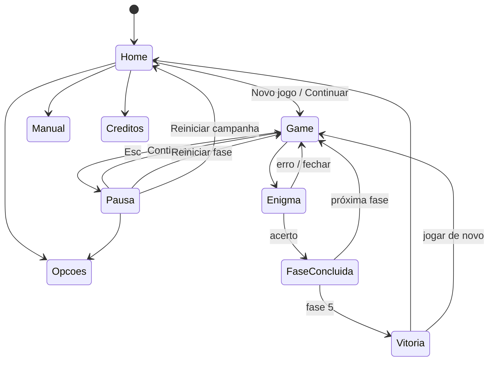

# Mistério na Estação — Arquitetura técnica

Versão 2.0 · 18/11/2026 · Arquiteto de Software

Esta versão substitui a v1.0. A v1.0 propunha remover o Phaser e reescrever a interface em React. Depois de revisar o protótipo já jogável em `src/main.ts`, a decisão foi mantida a pilha atual e corrigidos os limites: **Phaser desenha a cena; o DOM concentra texto, controles, regras e acessibilidade**. Reescrever uma base que já funciona não traz benefício ao jogador e atrasa a entrega.

O escopo narrativo e a direção de arte continuam em `ESCOPO.md` e `docs/design-e-arquitetura.md`. Onde este documento divergir da seção 10 daquele arquivo, vale este.

## 1. Decisão em uma página

| Área | Decisão | Motivo curto |
|---|---|---|
| Cenas | Phaser 3, somente apresentação | Já desenha as cinco salas, escala e responde ao ponteiro. |
| Interface | DOM + TypeScript, sem framework | Diário, opções, pausa e enigmas já são DOM; não há ganho em trocar. |
| Build | Vite 7 | Build estático pequeno e rápido, já configurado. |
| Estado | `GameStore` explícito, separado do DOM | O `save` global atual dificulta teste e migração. |
| Salvamento | `localStorage` com campanha e opções separadas | Save pequeno, local, sem conta ou servidor. |
| Som | Web Audio API sintetizado | Original, sem licenças e sem arquivos pesados. |
| Desktop | Electron + electron-builder | Node já instalado, sem Rust e sem serviço pago. |
| Web | Build estático na Vercel | CLI já autenticada; GitHub Pages é alternativa. |
| Testes | Vitest + Playwright (Python) | Regras em unidade e percurso real no navegador. |
| Backend | Nenhum | Um jogador, sem nuvem, telemetria ou custo recorrente. |

A regra que organiza tudo: **o Phaser não decide nada**. Ele recebe o índice da fase e as pistas encontradas, desenha a sala, emite `inspect-clue` quando alguém clica num ponto e para. Regras, save, áudio, textos e enigmas vivem fora dele.

## 2. Limite entre Phaser e DOM

### O que o Phaser faz

- Desenha o fundo geométrico de cada sala, a luz, o piso e os objetos.
- Desenha os marcadores dos pontos de interesse.
- Recebe ponteiro/toque nos marcadores e emite o id da pista.
- Reage ao redimensionamento do espaço da cena.

### O que o Phaser não faz

- Não lê nem grava `localStorage`.
- Não toca áudio.
- Não abre modal, diário, opções ou enigma.
- Não decide se uma pista existe, se a fase avançou ou se o jogador venceu.
- Não contém texto essencial que não esteja também no DOM.

### O que o DOM faz

- Lista **todos** os pontos de interesse em botões reais (`#clue-buttons`). Essa lista é a interface canônica: funciona por teclado, leitor de tela, toque e mouse.
- Mostra o texto da pista, o diário, o objetivo, as opções, a pausa e os enigmas.
- Mantém o foco, os diálogos, o `aria-live` e as confirmações.
- Pode jogar a fase inteira sem o canvas. Se o Phaser falhar, a lista de pontos continua.

O canvas é uma ilustração interativa, não a única porta de entrada. Ele deve ter `aria-hidden="true"` e não receber foco; os botões da lista carregam o nome acessível. Quem usa mouse ou toque pode clicar nos dois lugares.

### Falha do canvas

Se `new Phaser.Game(...)` lançar erro ou o contexto WebGL não existir, o app:

1. adiciona a classe `scene-unavailable` ao palco;
2. mostra um aviso curto: "A ilustração não pôde ser carregada; use a lista de pontos ao lado";
3. mantém a lista, o diário e os enigmas funcionando.

O jogo nunca depende de WebGL para avançar.

## 3. Estrutura de pastas

O protótipo atual concentra tudo em `src/main.ts` (mais de 40 KB) e `src/style.css`. A primeira tarefa é dividir sem mudar comportamento.

```text
misterio-na-estacao/
  index.html
  package.json
  vite.config.ts
  tsconfig.json
  electron-builder.yml
  electron.cjs
  src/
    main.ts                    # só inicializa o app
    app/
      bootstrap.ts             # carrega save, monta store, liga telas
      router.ts                # home | game | vitória + modal
    game/
      content/
        phases.ts              # registro das 5 fases
        phases/
          f01-plataforma.ts
          f02-saguao.ts
          f03-controle.ts
          f04-deposito.ts
          f05-cabine.ts
        manual.ts
        credits.ts
      state/
        types.ts               # CampaignState, Options, PuzzleStep
        store.ts               # GameStore + ações
        selectors.ts           # fase atual, pistas encontradas, pode resolver
        migrate.ts             # save antigo -> v2
      save/
        campaign.ts            # validar, carregar, gravar campanha
        options.ts             # validar, carregar, gravar opções
        storage.ts             # adaptador com fallback em memória
      puzzle/
        validate.ts            # respostas por tipo de passo
      scene/
        StationScene.ts        # Phaser, somente desenho + evento
        draw/
          f01.ts ... f05.ts    # uma função de desenho por sala
      audio/
        AudioEngine.ts
    ui/
      dom.ts                   # qs, el, escapeHtml, foco
      modal.ts                 # abrir/fechar, foco, retorno
      screens/
        home.ts
        game.ts
        victory.ts
      panels/
        cluePanel.ts
        journal.ts
        options.ts
        pause.ts
        manual.ts
        credits.ts
        deduction.ts
      components/
        confirm.ts
        toast.ts
        progressRail.ts
        saveStatus.ts
    design/
      tokens.css
      base.css
      layout.css
      components.css
  tests/
    unit/
    e2e/
  docs/
    arquitetura.md
    plano-de-implementacao.md
    design-e-arquitetura.md
    ASSETS-LICENCIAS.md
  public/
    assets/                    # só se o Artista entregar imagens/áudio
  release/                     # artefatos do Electron, fora do Git
```

Regras:

- `src/main.ts` não contém regra, conteúdo nem HTML gigante. Só chama `bootstrap()`.
- `scene/` não importa `state/`, `save/`, `ui/` nem `audio/`. Recebe dados e emite eventos.
- `state/` não importa DOM, Phaser, áudio nem Electron. É testável em Node.
- `ui/` não lê `localStorage` diretamente. Usa o store e os módulos de save.
- `content/` não importa nada do app. É dado tipado.
- Uma fase por arquivo. Adicionar fase não edita as outras.
- Tokens de cor, tipografia e movimento em `design/tokens.css`; nenhum hexadecimal solto em componente.

## 4. Modelo de conteúdo

O modelo atual (`Phase` com `choices`) cobre o protótipo, mas todos os enigmas são a mesma escolha múltipla. O escopo pede variação: rotação no saguão, sequência no controle, código no depósito e ordenação na cabine. O tipo abaixo substitui `choices` por passos.

```ts
export type PhaseId = "f01" | "f02" | "f03" | "f04" | "f05";

export interface Clue {
  id: string;              // único na campanha: "f01.bilhete"
  phase: PhaseId;
  title: string;
  text: string;
  icon: string;
}

export interface Hotspot {
  clueId: string;          // o ponto sempre aponta para uma pista
  x: number;               // 0..1, relativo à cena
  y: number;               // 0..1
}

export interface Phase {
  id: PhaseId;
  order: number;
  name: string;
  place: string;
  objective: string;
  intro: string;
  ambience: string;
  clues: Clue[];
  requiredClues: number;   // mínimo para liberar o enigma
  puzzle: Puzzle;
  hints: [string, string, string];
  visual: number;          // índice do desenho em scene/draw
}

export interface Puzzle {
  prompt: string;
  steps: PuzzleStep[];
  successText: string;
}

export type PuzzleStep =
  | { kind: "choice"; id: string; prompt: string; options: { id: string; label: string }[]; answerId: string; wrong: string }
  | { kind: "sequence"; id: string; prompt: string; items: { id: string; label: string }[]; answer: string[]; wrong: string }
  | { kind: "rotate"; id: string; prompt: string; tiles: { id: string; label: string; correct: 0 | 90 | 180 | 270 }[]; wrong: string }
  | { kind: "code"; id: string; prompt: string; length: number; answer: string; wrong: string };
```

### Enigmas por fase

| Fase | Passos | O que o jogador faz |
|---|---|---|
| 1 Plataforma | `choice` + `choice` | Confirma horário e plataforma. |
| 2 Saguão | `rotate` + `choice` | Gira três partes do mapa e escolhe a rota. |
| 3 Controle | `sequence` | Ordena norte, lateral, central. |
| 4 Depósito | `code` | Digita o número da mala (217). |
| 5 Cabine | `sequence` + `choice` | Ordena as quatro evidências e escolhe a explicação. |

Cada passo tem **Conferir**. Acerto avança; erro mostra `wrong`, incrementa `mistakes[phase]` e mantém o estado local. O último acerto conclui a fase. Não existe derrota.

### Regras de conteúdo

- Todo `clueId` de hotspot existe na fase.
- Todo id é único na campanha; a fase entra no prefixo.
- `requiredClues` é menor ou igual ao número de pistas da fase.
- Respostas referenciam ids existentes; `sequence` não repete id.
- `x` e `y` ficam entre 0 e 1; o marcador não sai da cena.
- Nenhuma pista essencial depende de som, cor, vibração ou animação.
- O texto do manual e das dicas não entrega a resposta antes da hora.
- O teste de integridade roda em CI e falha se qualquer regra acima quebrar.

## 5. Estado e salvamento

### Separação

O protótipo guarda campanha e preferências no mesmo objeto. Isso faz "reiniciar campanha" precisar preservar `prefs` manualmente e impede migrar uma coisa sem a outra. A v2 separa:

```ts
export interface CampaignState {
  version: 2;
  phase: number;           // 0..4
  clues: string[];
  completed: number[];
  mistakes: number[];      // cinco posições
  won: boolean;
}

export interface Options {
  version: 2;
  music: number;           // 0..100
  ambience: number;        // 0..100
  effects: number;         // 0..100
  muted: boolean;
  vibration: boolean;      // padrão false
  reduceMotion: "system" | "on" | "off";
  textScale: 100 | 115 | 130;
}
```

Chaves:

```text
misterio-estacao:campaign:v2
misterio-estacao:options:v2
misterio-estacao:campaign:corrupt
misterio-estacao-save-v1        # legado, só para migrar
```

### Migração do protótipo

Ao abrir, se não existir a chave v2 e existir `misterio-estacao-save-v1`:

1. ler o objeto antigo;
2. validar `phase`, `clues`, `completed`, `mistakes`, `won`;
3. copiar `prefs` para `Options` v2, corrigindo faixas;
4. gravar campanha e opções v2;
5. manter a chave antiga por uma versão, sem apagar.

Se a migração falhar, não apagar nada. Mostrar "Não foi possível ler o progresso anterior" e oferecer **Novo jogo**; guardar a cópia crua em `campaign:corrupt`.

### Validação

- `version` exatamente 2.
- `phase` inteiro entre 0 e 4.
- `completed` sem repetição e compatível com `phase`.
- `clues` só com ids existentes no conteúdo.
- `mistakes` com cinco números não negativos.
- `won` só é aceito se `completed` contém as cinco fases; senão, corrigir para `false`.
- Opções: números em 0–100; `textScale` em 100/115/130; `reduceMotion` em system/on/off.

Save inválido não é apagado. A cópia crua vai para `campaign:corrupt` e o menu explica. Não fingir que há progresso.

### Quando gravar

Gravar depois de: coletar pista, errar tentativa, concluir fase, reiniciar fase/campanha, iniciar campanha e mudar opção. Debounce de 150 ms para não escrever a cada clique. Gravar também em `visibilitychange`/`pagehide` se houver alteração pendente.

Se `localStorage` falhar (cota, modo privado, bloqueio), o store continua em memória e mostra uma faixa: "Não foi possível salvar neste navegador; o progresso vale só nesta sessão." O jogo não trava.

### GameStore

Um objeto pequeno, sem framework:

```ts
class GameStore {
  getState(): { campaign: CampaignState; options: Options };
  subscribe(fn: () => void): () => void;
  collectClue(id: string): void;
  recordMistake(): void;
  completePhase(): void;
  restartPhase(): void;
  restartCampaign(): void;
  finishCampaign(): void;
  setOption<K extends keyof Options>(key: K, value: Options[K]): void;
}
```

Cada método valida a transição, atualiza o estado imutável, notifica os assinantes e agenda o save. As telas só chamam métodos; não mutam `campaign` diretamente. Isso permite testar a campanha inteira em Node, sem navegador.

### Regras de reinício

- **Reiniciar fase:** remove as pistas da fase atual e seguintes, zera `mistakes[phase]`, mantém fases anteriores e opções. Confirmar antes.
- **Reiniciar campanha:** zera campanha, mantém opções. Confirmar antes.
- **Novo jogo com campanha existente:** substitui a campanha, mantém opções. Confirmar antes.
- **Cancelar:** não altera nada e devolve o foco ao botão de origem.

## 6. Telas, modais e foco

Fluxo:



- Sem roteador. `home` e `game` são seções; o resto são modais sobre a tela atual. O botão Voltar do navegador não deve interromper a partida.
- Um único `<dialog id="modal">` no HTML. `openModal` guarda o elemento que tinha foco, abre com `showModal()`, foca o título ou o primeiro controle, e `closeModal` devolve o foco.
- `Esc` fecha o modal do topo; se não houver modal e o jogo estiver aberto, abre a pausa.
- O título do modal recebe `id="modal-title"` e o `<dialog>` aponta `aria-labelledby`.
- Ações destrutivas usam `ConfirmDialog`; **Cancelar** é o foco inicial e a ação primária não é destrutiva por padrão.
- Ao trocar de fase, o foco vai para o `<h1 id="phase-title">` com `tabIndex={-1}`; o leitor de tela anuncia a nova sala.
- `aria-live="polite"` anuncia pista registrada, erro, acerto e status de save. Não usar `assertive`.

### Conteúdo dinâmico e HTML

O protótipo usa `innerHTML` com textos do conteúdo. Como o conteúdo é estático e revisado, o risco é baixo, mas a regra passa a ser:

- `innerHTML` só para estrutura estática sem dados externos.
- Texto de pista, título e mensagem entram por `textContent` ou por um helper `escapeHtml`.
- Nunca interpolar entrada de usuário, URL ou `localStorage` em template HTML.
- Nada de `eval`, scripts inline ou conteúdo remoto.

## 7. Cena, controles e responsividade

- O palco mantém a proporção da cena; `Phaser.Scale.RESIZE` já acompanha o contêiner. O CSS define altura mínima/máxima e `aspect-ratio` para não colapsar.
- A lista de pontos ao lado é a interface principal. Cada botão mostra número, ícone, título e estado (`Nova` / `Registrada`), com `aria-pressed` inicial correto.
- O marcador no canvas é um atalho visual. Ele não é a única forma de inspecionar.
- Alvos de toque no DOM têm pelo menos 44×44 CSS px e espaço entre si. O canvas também usa raio de toque confortável.
- Não usar hover para revelar informação. O cursor muda; o foco desenha contorno.
- Celular: uma coluna; cena no topo, lista de pontos e ações abaixo; diário em modal largo com rolagem interna.
- Desktop: cena à esquerda, painel de inspeção à direita; largura máxima de 1440 px.
- Retrato e paisagem funcionam. Em altura pequena, a cena reduz e a lista continua acessível; mostrar "Gire o aparelho para ver a cena maior" sem bloquear.
- `env(safe-area-inset-*)` no topo, base e laterais.
- Texto em `rem`, com `--text-scale` em 100/115/130%. O layout reflui; nenhum botão sai da tela.
- Evitar `100vh`; usar `100dvh` e `min-height`.
- Zoom de 200% não pode esconder ações.

## 8. Acessibilidade

Meta: WCAG 2.2 AA nas telas de interface e nos enigmas. Nenhuma informação essencial só por som, cor, vibração, movimento ou tempo.

Checklist obrigatório:

- Contraste mínimo 4,5:1 para texto normal e 3:1 para texto grande, ícones e foco. Conferir os pares reais da paleta.
- Foco visível em todos os controles; nenhum `outline: none` sem substituto.
- Lista de pontos com nome acessível e estado; canvas `aria-hidden`.
- Modal com título associado, foco preso, Esc e retorno de foco.
- Enigmas operáveis por teclado:
  - escolha: Tab + Enter/Espaço;
  - sequência: botões **Mover para cima/baixo**;
  - rotação: botão **Girar** por peça;
  - código: `<input>` com `inputMode="numeric"` e botão **Conferir**.
- Arrastar nunca é obrigatório. Se existir, há alternativa por seleção e botões.
- Resultado de enigma em `aria-live="polite"`; erro não move o foco para longe do campo.
- Descrição textual da sala em parágrafo visível ou `sr-only`; a lista de pontos complementa.
- Nenhum limite de tempo.
- `prefers-reduced-motion` e a opção do jogo desligam transições, partículas e deslocamentos.
- Sem flashes ou piscadas rápidas em nenhuma configuração.
- Texto ampliável em 130% e zoom 200% sem perda de conteúdo.
- Manual dentro do jogo repete os controles e não depende de imagem.

Testes manuais: NVDA no Windows e VoiceOver no iPhone, se disponíveis. Registrar o que foi testado; não declarar compatibilidade sem evidência.

## 9. Áudio, vibração e movimento

### Áudio sintetizado

O `AudioEngine` atual já cria um oscilador e efeitos. A v2 separa três barramentos:

- **Música:** acordes sustentados e notas espaçadas, agendadas a cada 8–12 s, com filtro suave.
- **Ambiente:** ruído filtrado (vento), tique de relógio e zumbido de relés, por fase.
- **Efeitos:** envelopes curtos para examinar, coletar, acertar, errar, dica e vitória.

Regras:

- `AudioContext` só é criado ou retomado depois de gesto do jogador.
- Volume independente de música, ambiente e efeitos; **Silenciar tudo** é reversível.
- `visibilitychange` suspende; ao voltar, retoma se estava tocando e não estava mudo.
- Sem informação essencial só no som.
- Se Web Audio não existir ou for bloqueado, o jogo funciona em silêncio e as opções explicam.
- Se o Artista entregar arquivos, usar **M4A/AAC** principal e **OGG/Opus** alternativo. OGG sozinho não toca em Safari/iOS; essa é uma correção ao texto do escopo.

### Vibração

- `navigator.vibrate` é opcional e desligada por padrão.
- Detectar suporte; se não houver, mostrar "Indisponível neste dispositivo" e não chamar a API.
- Padrão curto de 12–20 ms em pista ou solução; nunca repetir sem ação.
- Não pede permissão e não é necessária para resolver nada.

### Movimento

- Respeitar `prefers-reduced-motion` na carga e ouvir mudanças.
- A opção **Reduzir movimento** desliga partículas, paralaxe, tremor e transições; mudanças ficam instantâneas.
- Sem flashes, piscadas rápidas ou zoom brusco.
- Transições de fase são dissoluções curtas, no máximo 400 ms.

## 10. Aplicativo desktop

O mesmo build web é carregado pelo Electron. Não há código de jogo duplicado.

### Processo principal

- `contextIsolation: true`, `nodeIntegration: false`, `sandbox: true`.
- Sem `preload` e sem ponte Node: a página não precisa de API do sistema.
- Protocolo próprio `app://bundle/` em vez de `file://`. Vantagens: origem estável para `localStorage`, caminhos absolutos do Vite funcionam e o comportamento fica igual ao da web. Registrar o esquema como privilegiado (`standard`, `secure`, `supportFetchAPI`) antes de `app.whenReady()` e tratar com `protocol.handle`, bloqueando traversal (`..`, caminhos absolutos e symlinks).
- Bloquear navegação para fora do `app://` e negar `window.open`. Links externos, se existirem nos créditos, só abrem com `shell.openExternal` e lista de permissão.
- Negar todas as permissões de sessão (câmera, microfone, geolocalização etc.).
- CSP no cabeçalho da sessão, equivalente à da web.
- Instância única (`app.requestSingleInstanceLock()`), janela 1280×800, mínimo 760×620, `center: true`.
- F11 alterna tela cheia; Esc continua sendo pausa. Menu nativo removido em produção; DevTools só em desenvolvimento.
- Lembrar tamanho/posição da janela em `userData/window.json` é P2.

### Empacotamento

- `electron-builder` com alvos Windows `nsis` (instalador) e `portable` (executável único).
- Ícone `build/icon.ico` 256×256, do Artista. Sem ícone, o Electron usa o padrão e a entrega fica amadora.
- Versão em `package.json`, sincronizada com a tag do GitHub.
- O executável **não é assinado**. O SmartScreen pode avisar; o README explica "Mais informações → Executar assim mesmo". Assinatura custa dinheiro e fica fora do escopo. Publicar SHA-256.
- Tamanho esperado: 60–90 MB no portable, 80–120 MB instalado. É o custo do Electron; não há serviço pago.

### Por que não Tauri

Tauri geraria um app menor, mas exige Rust e MSVC, que não estão instalados. Electron usa o Node presente e o mesmo build. Se o tamanho virar problema real, Tauri pode ser reavaliado depois, com o código web intacto.

## 11. Web, PWA e publicação

- **Hospedagem principal:** Vercel, projeto estático, `npm run build`, saída `dist`. CLI autenticada como `leosilvabh77-3370`. Sem funções de servidor.
- **Alternativa:** GitHub Pages, com caminhos relativos (`base: "./"`). Limites atuais são suficientes.
- **Cabeçalhos na Vercel:** CSP, `X-Content-Type-Options: nosniff`, `Referrer-Policy: no-referrer`, `Permissions-Policy` sem câmera/microfone/geolocalização, cache longo para `/assets/*` com hash e curto para `index.html`.
- **PWA (P2):** manifest, ícones e service worker com `vite-plugin-pwa`. Instalável; atualização explícita ("Nova versão disponível — recarregar"), nunca no meio de uma fase.
- **GitHub:** repositório com README, controles, requisitos, licença e `ASSETS-LICENCAS.md`. A release recebe portable, instalador e checksums.
- **Publicação só depois da validação** do plano. O usuário autorizou; ainda assim, os links só são divulgados quando o percurso completo passar.

## 12. Estratégia de testes

### Unitários (Vitest)

- Store: nova campanha, coleta repetida, pista inexistente, bloqueio por pistas faltantes, três erros, conclusão das cinco fases, reinício de fase/campanha, vitória.
- Save: ida e volta, campos faltando, versão desconhecida, ids inexistentes, fase fora da faixa, JSON inválido, cota cheia, migração do v1.
- Opções: padrões, clamp, valor inválido, persistência separada.
- Conteúdo: ids únicos, referências válidas, respostas existentes, coordenadas 0–1, todas as fases alcançáveis, todo `requiredClues` coletável, nenhum texto vazio.
- Enigmas: cada tipo valida resposta certa/errada e não aceita passo incompleto.

### Componentes (Testing Library ou DOM puro)

- Continuar só aparece com save válido.
- Modal prende foco, Esc fecha e devolve foco.
- Lista de pontos responde a Enter/Espaço; `aria-pressed` correto.
- Passos de enigma operáveis só com teclado; rotação e ordem sem arrastar.
- Aviso de save indisponível aparece e não bloqueia.

### Ponta a ponta (Playwright com Python)

O Playwright já está instalado (`playwright.exe`, Python 3.12); os testes usam essa instalação, sem baixar navegador via npm.

- Servidor: `npm run build` e `npm run preview -- --port 4173`; o teste espera a porta.
- Desktop: 1280×800, mouse e teclado.
- Celular: 390×844, `has_touch=True`, sem hover.
- Percurso: Novo jogo → cinco fases → vitória; recarregar no meio e Continuar; pausa; reiniciar fase com cancelar e confirmar; reiniciar campanha; save corrompido; opções persistentes.
- Teclado: percurso completo só com Tab/Enter/Setas.
- Evidência: screenshots em `tests/e2e/artefatos/` e log de cada passo.

Comandos:

```bash
npm run test          # Vitest
npm run test:watch
npm run test:e2e      # pytest tests/e2e
npm run build
npm run preview
```

### Verificação manual antes da entrega

- Chrome/Edge no desktop; Firefox; Safari no iPhone e no Mac, se disponível.
- Zoom de 200% e texto em 130%.
- NVDA no Windows; VoiceOver no iPhone.
- Contraste dos pares reais.
- Sem áudio, sem vibração e com movimento reduzido: o jogo continua compreensível.
- Electron: instalar, abrir, jogar uma fase, fechar, reabrir e Continuar.
- Registrar o que foi testado e em qual ambiente.

## 13. Segurança e privacidade

- Sem login, banco, API, analytics, cookies de terceiros, anúncios ou compras.
- Nenhum dado sai do dispositivo. O save contém apenas progresso e preferências; não pedir nome, e-mail ou idade.
- Todo asset é local. Sem CDN, fontes do Google ou scripts de terceiros.
- CSP restritiva. Posições de marcador usam coordenadas no canvas, não estilo inline; se houver variável CSS inline, liberar apenas `style-src-attr 'unsafe-inline'`.
- Texto dinâmico escapado; `innerHTML` só para estrutura estática. Sem `dangerouslySetInnerHTML` (não há React).
- Electron: sem Node na página, sem preload, sem navegação externa, permissões negadas.
- Dependências: manter `package-lock.json`, rodar `npm audit` antes da entrega.
- Conteúdo 13+: sem violência gráfica, sustos, conteúdo sexual ou linguagem imprópria. Não alegar classificação oficial.

## 14. Custos

| Item | Custo | Observação |
|---|---|---|
| GitHub (repositório e releases) | R$ 0 | Limites gratuitos suficientes. |
| Vercel Hobby (site estático) | R$ 0 | Uso pessoal; sem funções de servidor. |
| Electron e electron-builder | R$ 0 | Build local. |
| Áudio e arte | R$ 0 | Síntese própria e arte geométrica original. |
| Domínio próprio | Opcional | O subdomínio `*.vercel.app` evita custo. |
| Assinatura do executável | Opcional | Sem certificado, o SmartScreen avisa. Não contratar agora. |

Não há serviço pago obrigatório. Nuvem, contas ou loja de aplicativos exigem nova decisão e autorização.

## 15. Riscos e mitigação

| Risco | Impacto | Mitigação |
|---|---|---|
| `main.ts` monolítico | Difícil manter e testar | Dividir por assunto no Marco 1, sem mudar comportamento. |
| Canvas como única entrada | Bloqueia teclado e leitor de tela | Lista DOM canônica já existe; canvas vira `aria-hidden` e atalho. |
| Enigmas todos iguais | Não cumpre o escopo | Passos `choice/sequence/rotate/code` no Marco 4. |
| Save antigo do protótipo | Perda de progresso | Migração v1 → v2 e cópia de corrupção; não apagar. |
| Modal sem retorno de foco | Desorientação | `modal.ts` com foco guardado e devolvido. |
| Electron `file://` | Save instável e segurança fraca | Protocolo `app://` no Marco 5. |
| Áudio bloqueado no iOS | Silêncio inesperado | Início após gesto; fallback e aviso nas opções. |
| Texto grande quebra layout | Ação inacessível | `rem`, reflow, testes em 130% e zoom 200%. |
| Sem assinatura no Windows | Aviso do SmartScreen | Portable + SHA-256 + instrução no README. |
| Publicação antes da validação | Link quebrado | Marco 7 e 8 antes de divulgar. |

## 16. Guia curto: nova tela ou fase

### Nova tela/painel

1. Criar `src/ui/panels/Nome.ts` exportando `openNome()` e, se necessário, `close`.
2. Usar `modal.ts` para abrir; nunca criar outro `<dialog>` solto.
3. Montar o conteúdo com `textContent` para dados e `innerHTML` só para estrutura estática.
4. Registrar as ações no `data-action` do modal ou em listeners locais; devolver foco ao fechar.
5. Usar tokens de `design/tokens.css`; nenhum hexadecimal novo.
6. Adicionar um teste de componente para o estado principal e um caminho de volta.

### Nova fase

1. Criar `src/game/content/phases/f06-nome.ts` seguindo `Phase`.
2. Registrar em `content/phases.ts`, na ordem.
3. Criar a função de desenho em `scene/draw/f06.ts` ou um asset local.
4. Definir pistas e hotspots em coordenadas 0–1; conferir no navegador.
5. Definir `requiredClues`, três dicas e `puzzle.steps` válidos.
6. Rodar o teste de integridade; ele aponta ids e referências quebradas.
7. Jogar por teclado e por toque antes de considerar pronta.

## 17. Passagem para a implementação

Ordem: modularizar sem mudar comportamento → salvar/opções/migração → acessibilidade e foco → enigmas variados → Electron → responsivo → testes ponta a ponta → publicação.

O que já existe: protótipo jogável com cinco fases, cena Phaser, pistas, diário, opções, áudio sintetizado, save local e Electron inicial. O que falta para o produto: estrutura modular, save v2, enigmas variados, acessibilidade completa, Electron seguro, testes e publicação.

O que o Léo precisa fornecer: nada para continuar. Para publicar, o login do `gh` precisa ser renovado; a Vercel já está autenticada. O Artista pode entregar fundos e ícones, mas o jogo não bloqueia sem eles.

Critério de arquitetura pronta: o desenvolvedor implementa sem decidir tecnologia, formato de save, estrutura de pastas ou estratégia de teste; e o QA reproduz o percurso em navegador desktop, navegador móvel e Electron.
